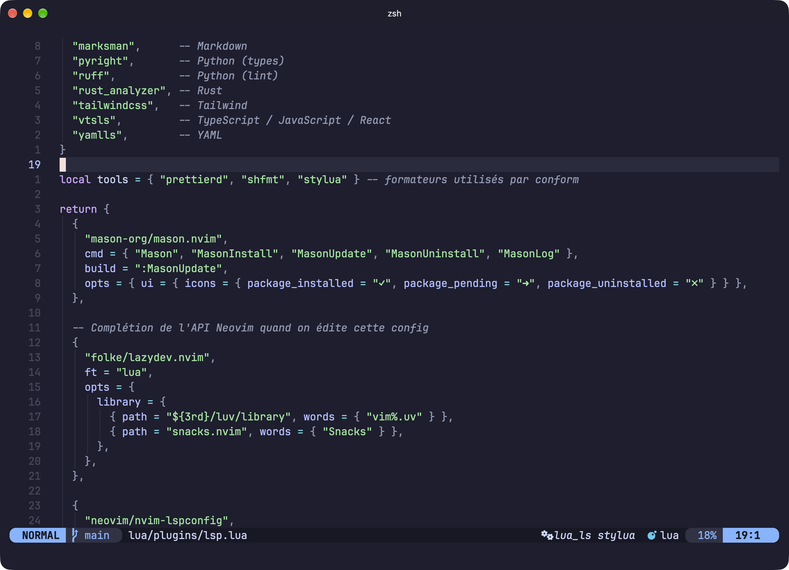
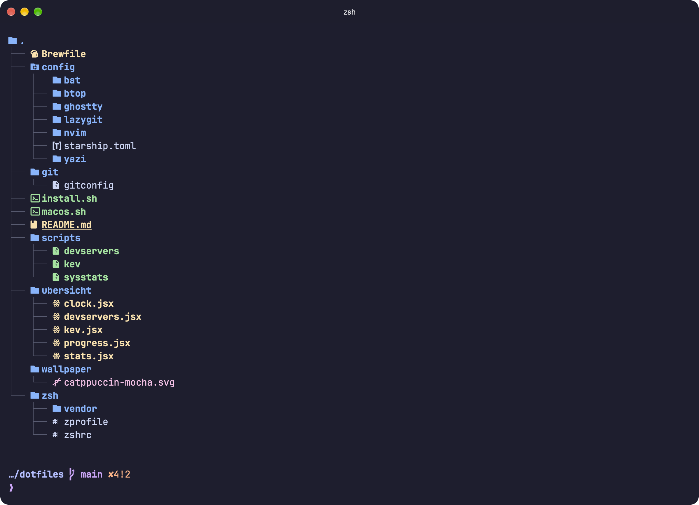
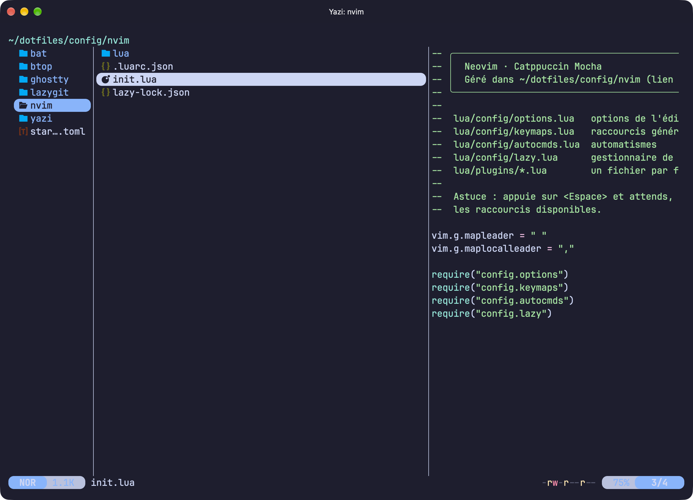
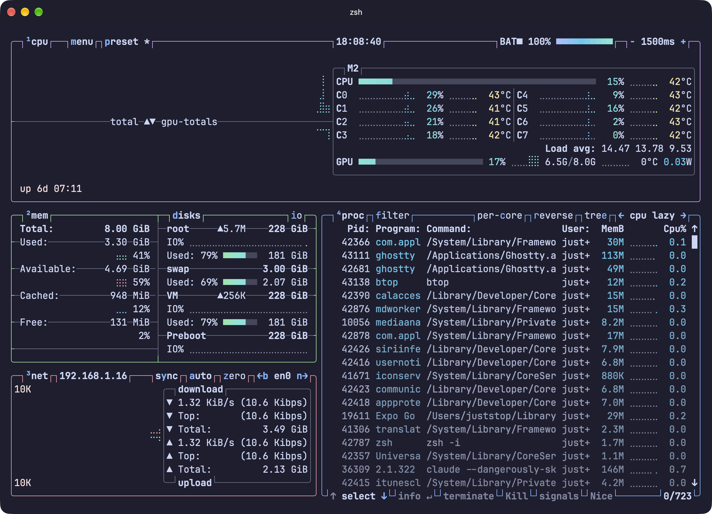
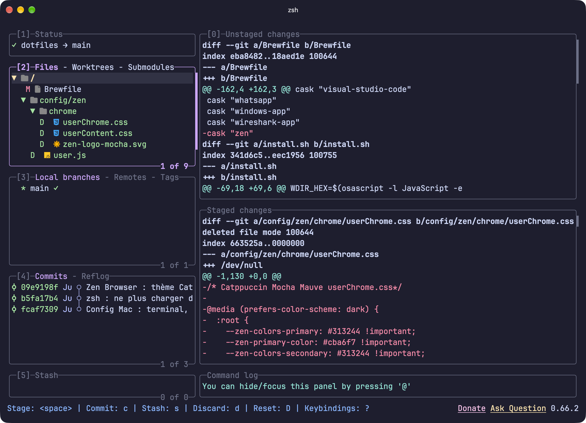

<div align="center">

# 🪶 dotfiles · Catppuccin Mocha

**Toute la configuration de mon Mac au même endroit** — terminal, shell, Neovim, widgets et réglages système.
Un seul thème partout : [Catppuccin Mocha](https://catppuccin.com). Une seule commande pour tout réinstaller.

<br>


<br>



</div>

## 🚀 Installation (one-shot)

Sur un Mac neuf, une seule ligne clone le dépôt et installe **tout** :

```sh
git clone https://github.com/juststopp/mac-config.git ~/dotfiles && ~/dotfiles/install.sh
```

`install.sh` est **relançable sans risque** : il installe Homebrew et les apps du `Brewfile`, crée les liens symboliques (en sauvegardant l'existant dans `~/.dotfiles-backup/`), met en place plugins et thèmes, puis applique les réglages macOS.

```sh
~/dotfiles/install.sh            # tout
~/dotfiles/install.sh --no-brew  # sans réinstaller les apps (juste liens + réglages)
```

> Les fichiers de `~` (`~/.zshrc`, `~/.config/nvim`…) sont des **liens** vers ce dépôt :
> modifier ici = modifier partout. Première fois : lance `nvim` une fois pour installer les plugins.

## 🖼️ Aperçu

<div align="center">
<table>
  <tr>
    <td align="center" width="50%">
      <br>
      <sub><b>Shell</b> · zsh sans Oh My Zsh · prompt Starship · <code>eza</code></sub>
    </td>
    <td align="center" width="50%">
      <br>
      <sub><b>Yazi</b> · explorateur de fichiers avec aperçu</sub>
    </td>
  </tr>
  <tr>
    <td align="center" width="50%">
      <br>
      <sub><b>btop</b> · moniteur système</sub>
    </td>
    <td align="center" width="50%">
      <br>
      <sub><b>lazygit</b> · git au clavier, diffs via delta</sub>
    </td>
  </tr>
</table>
</div>

## 📦 Ce qu'il y a dedans

| Dossier | Rôle |
|---|---|
| `zsh/` | `.zshrc` (plugins, alias, fzf, complétion dans fzf) et `.zprofile` (PATH) — **sans Oh My Zsh**, plugins chargés directement |
| `config/nvim/` | Neovim écrit de zéro : `lazy.nvim`, LSP (Mason), Treesitter, `snacks`, `blink.cmp`, formatage auto… |
| `config/ghostty/` | Terminal **Ghostty** : police, splits, terminal déroulant global |
| `config/starship.toml` | Prompt **Starship** |
| `config/{bat,btop,yazi,lazygit}/` | Thèmes et réglages des outils CLI |
| `ubersicht/` | Widgets du bureau (**Übersicht**) : horloge, progression de l'année, serveurs de dev, CISA KEV, stats système |
| `scripts/` | `sysstats`, `devservers`, `kev` : données des widgets (utilisables aussi dans le terminal) |
| `Brewfile` | Toutes les apps et outils (`brew bundle dump --force` pour le régénérer) |
| `macos.sh` | Bureau sans icônes, Dock auto, captures dans `~/Pictures/Screenshots`, fond d'écran |
| `install.sh` | Orchestre tout, relançable |

**Outils principaux** : Ghostty · Neovim · Starship · `eza` · `bat` · `fd` · `fzf` · `zoxide` · `yazi` · `btop` · `lazygit` · `delta` · `ripgrep`.

## ⌨️ Aide-mémoire

### Terminal

| Commande / touche | Effet |
|---|---|
| `Ctrl+R` | Rechercher dans l'historique (fzf) |
| `Ctrl+T` | Insérer un fichier (avec aperçu) |
| `Tab` | Complétion dans fzf, avec aperçu des dossiers |
| `→` | Accepter la suggestion grise |
| `z <nom>` / `cd <nom>` | Sauter vers un dossier déjà visité (zoxide) |
| `y` | Explorateur de fichiers yazi (le terminal suit le dossier en sortant) |
| `l`, `ll`, `lt` | Lister (détails, arbre) avec icônes et statut git |
| `lg` | lazygit |
| `btop` | Moniteur système |
| `tldr <cmd>` | Exemples rapides d'une commande |
| `mac-clean` | Vider les caches npm / Homebrew / Xcode |
| `brewup` | Tout mettre à jour |
| `nano`, `vim`, `v` | Ouvrent Neovim |
| `Cmd+Échap` | Terminal déroulant Ghostty, depuis n'importe quelle app |
| `Cmd+D` / `Cmd+Maj+D` | Diviser Ghostty à droite / en bas |

### Neovim (leader = `Espace`)

Appuie sur `Espace` et attends : la liste complète s'affiche (which-key).

| Touche | Effet |
|---|---|
| `Espace Espace` | Chercher un fichier |
| `Espace /` | Chercher du texte dans le projet |
| `Espace ,` | Fichiers ouverts |
| `Espace e` | Arborescence |
| `-` | Ouvrir le dossier comme un fichier (Oil) : renommer / supprimer en éditant, puis `:w` |
| `s` + 2 lettres | Sauter n'importe où à l'écran (flash) |
| `gd` / `gr` / `K` | Définition / références / documentation |
| `Espace ca` / `Espace cr` | Actions de code / renommer le symbole |
| `Espace cf` | Formater (auto à la sauvegarde ; `Espace uf` pour couper) |
| `Espace xx` | Liste des erreurs · `Espace xn` / `xp` : erreur suivante / précédente |
| `Espace gg` | lazygit |
| `Espace hn` / `hp` / `hs` | Modif git suivante / précédente / stager |
| `Espace tt` | Terminal flottant |
| `Shift+h` / `Shift+l` | Fichier ouvert précédent / suivant |
| `Ctrl+s` | Sauvegarder |
| `gsa"` / `gsd"` / `gsr"'` | Entourer de guillemets / les enlever / les remplacer |
| `Espace l` / `Espace cm` | Plugins (Lazy) / outils LSP (Mason) |

## 🗂️ Structure

```
dotfiles/
├── zsh/            .zshrc · .zprofile · plugins vendored
├── config/
│   ├── nvim/       Neovim (lazy.nvim, LSP, treesitter…)
│   ├── ghostty/    terminal
│   ├── bat/ btop/ yazi/ lazygit/   outils CLI
│   └── starship.toml
├── ubersicht/      widgets du bureau
├── scripts/        données des widgets
├── wallpaper/      fond d'écran Catppuccin
├── Brewfile        apps & outils
├── macos.sh        réglages système
└── install.sh      ← point d'entrée (one-shot)
```

<div align="center">
<sub>🤖 Réinstallable en une commande · 🎨 Catppuccin Mocha de bout en bout</sub>
</div>
